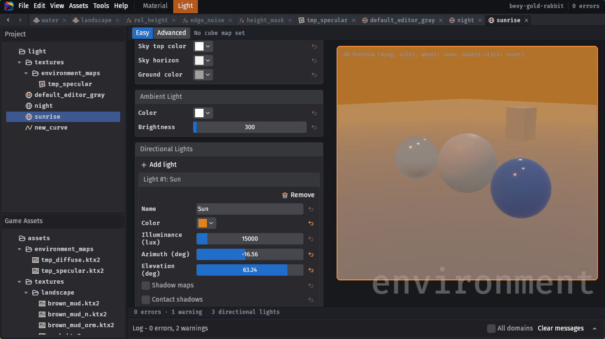
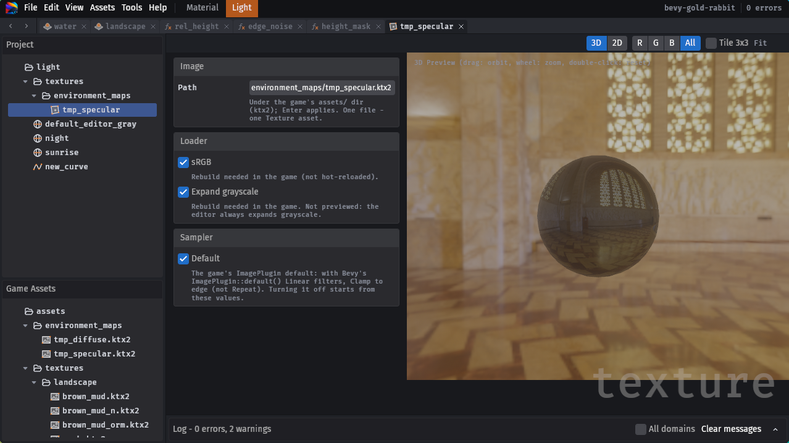

<p align="center">
  
</p>

<h1 align="center">Quillshade</h1>

<p align="center">
  <b>Standalone asset editor for <a href="https://bevy.org">Bevy</a>: author materials, textures, animations and other content.</b>
</p>

<p align="center">
  
  
  
  
</p>

> [!WARNING]
> **Alpha software — not stable, use at your own risk.** Quillshade is an unofficial, community-driven project and is
> not affiliated with or supported by the Bevy developers. File formats, generated code and the UI may change without
> notice between versions.
> Editor Code mostly written by LLMs

## What it is

Quillshade is an **external content tool** — closer to Blender than to the Unreal Editor. You run it next to your game,
it produces assets, and the game loads them like any other assets.

<p align="center">
  
</p>

- **Standalone.** A separate application that knows nothing about your game: not its components, systems, resources
  or scenes. It complements a scene editor such as [Jackdaw](https://github.com/jbuehler23/jackdaw) or the official
  Bevy editor instead of replacing it.
- **No levels, no scenes.** Placing entities and building levels is a scene editor's job; Quillshade does not do it
  and never will.
- **Not part of your build.** The game does not depend on Quillshade and does not know it exists. It depends only on
  the generated output — a plain Rust crate (Bevy, serde, ron), WESL shaders and data files — committed to your
  repository like hand-written code. Remove the editor and the game still builds.

In terms of data editing it is closer to a runtime inspector such as `WorldInspector`
([bevy-inspector-egui](https://github.com/jakobhellermann/bevy-inspector-egui)) — except it edits files on disk
instead of a running world:

<p align="center">
  
</p>


## Quick Start

### Download

Prebuilt binaries for Linux (x86_64), Windows (x86_64) and macOS (Apple Silicon, Intel) are attached to every
[release](https://github.com/fe3dback/bevy-quillshade/releases).

### Installation from source

Requires Rust ≥ 1.97.1 and the same system dependencies as Bevy itself (see
[Bevy setup](https://bevy.org/learn/quick-start/getting-started/setup/)).

```sh
git clone https://github.com/fe3dback/bevy-quillshade
cd bevy-quillshade
# Without the default `dynamic_linking` feature (fast builds while developing) the binary runs on its own.
cargo build --release --no-default-features
./target/release/shader-editor
```

### 1. Project

**File → New Project…** on your game crate (the directory with its `Cargo.toml`); domains can be toggled in **File → Project Settings…**.

```text
my_game/
  Cargo.toml                 # yours: the editor never edits it
  quillshade/
    project.ron              # optional: which domains are enabled
    material/                # your graphs: *.material.ron, *.function.ron, *.texture.ron, ...
    light/                   # environments, curves and cube maps: *.environment.ron, *.curve.ron, *.texture.ron
  assets/quillshade/material/autogen/    # generated WESL + baked.ron (do not edit)
  assets/quillshade/material/internal/   # built-in textures (generated)
  assets/quillshade/light/autogen/       # generated light baked.ron (do not edit)
  crates/quillshade/         # generated Rust crate, one module per domain (do not edit)
```

### 2. Cargo.toml

Add the generated crate to the game:

```toml
[workspace]
members = ["crates/quillshade"]

[dependencies]
bevy = { version = "0.20", features = ["file_watcher"] }   # file_watcher: hot reload
quillshade = { path = "crates/quillshade" }
```

### 3. Plugin

Add `QuillshadePlugin` after `DefaultPlugins`:

```rust
use bevy::prelude::*;

fn main() {
    App::new()
        .add_plugins((DefaultPlugins, quillshade::QuillshadePlugin))
        .run();
}
```

## Features

### Material Editor

Node-based material authoring in the spirit of the UE5 Material Editor. Graphs are saved as RON, and every save
regenerates WESL shaders and a typed Rust crate that the game hot-reloads.

<p align="center">
  
</p>

- **Three material kinds**: PBR 3D (an `ExtendedMaterial` over `StandardMaterial`, so shadows, prepass and deferred
  work out of the box), Unlit 3D and Sprite 2D. World Position Offset is supported too.
- **130+ built-in nodes**: math, vectors, colors, coordinates, textures, noise, masks and more. Implicit type
  conversions are applied on the wires.
- **Material Attributes**: make, break and blend whole PBR layers to build layered materials.
- **Functions**: reusable sub-graphs with their own inputs and outputs, shared across materials.
- **Custom code**: a Custom node with inline WESL, plus project-wide user nodes.
- **Curves**: a curve editor (Catmull-Rom or linear) whose curves are sampled from shaders.
- **Gradients**: collections of up to 128 gradients each (OKLab interpolation), baked into one texture per collection.
- **Textures**: Texture assets for the game's `.png` / `.ktx2` images, with loader and sampler settings and a preview.
- **Global constants**: named tables of values, inlined into every material that reads them.
- **Scene depth**: SceneDepth and DepthFade (soft particles, shorelines) read the camera's depth prepass in
  translucent 3D materials; add `DepthPrepass` to the camera.
- **Comfortable canvas**: comments, named routes, auto-layout, minimap, node preview, copy / paste,
  undo / redo, Back / Forward navigation.
- **Live validation**: errors and warnings are pinned to their node and pin, and an error blocks only its own asset.
- **Readable output**: view the generated WESL and Rust right in the editor. The game gets typed material structs and
  baked material and texture handles, and hot-reloads both the shaders and the baked values.
- **Headless CLI**: `regen`, `check` and `diff` for CI; `--domain <id>` (`material`, `light`; repeatable) limits a
  run to those domains (default: all), e.g. `shader-editor check my_game --domain light`.

<table>
  <tr>
    <td width="50%"><p align="center">Functions</p></td>
    <td width="50%"><p align="center">Curves</p></td>
  </tr>
  <tr>
    <td><p align="center">Gradients</p></td>
    <td><p align="center">Textures</p></td>
  </tr>
  <tr>
    <td><p align="center">Generated WESL</p></td>
    <td><p align="center">Generated Rust</p></td>
  </tr>
</table>

Every material is a field of `BakedMaterials`, by its path under `quillshade/material/`:

```rust
use quillshade::material::BakedMaterials;

fn spawn(mut commands: Commands, mut meshes: ResMut<Assets<Mesh>>, baked: Res<BakedMaterials>) {
    // Pbr3d needs tangents for a Normal input.
    let sphere = Sphere::new(1.0).mesh().uv(48, 24).with_generated_tangents().unwrap();
    commands.spawn((Mesh3d(meshes.add(sphere)), MeshMaterial3d(baked.env.rock_wet.clone())));
    commands.spawn((Camera3d::default(), Transform::from_xyz(0.0, 1.0, 4.0)));
}

// Unlit3d: MeshMaterial3d(baked.fx.hologram.clone()) as well.
// Sprite2d: (Sprite::from_image(image), SpriteMaterial(baked.ui.dissolve.clone())).
// By id, e.g. from your own asset data (None for an unknown id or another type):
// baked.get::<RockWetMaterial>("env/rock_wet"), tex.get("textures/rock_albedo").
```

#### Planned

- **Instanced materials**: material instances that share draw calls (draw-call optimization).

### Light

Set up the whole scene lighting environment in one editor with a live 3D preview: skybox and IBL cube maps (or a
procedural sky gradient), ambient and directional lights with shadows, distance fog, camera exposure, tonemapping and
color grading. Environments are generated as typed presets that the game can apply immediately or blend between smoothly
at runtime using custom transition curves, cross-fading skybox cube maps on the GPU and hot-reloading changes on the
fly. Includes a built-in **HDR Converter** tool (**Tools → HDR Converter…**) to convert equirectangular `.hdr`
panoramas into Bevy-ready `.ktx2` cube maps (`RGBA16Float` or `RGBA8 sRGB`, optional mipmaps and Zstd compression) with
live 2D and 3D previews.

<table>
  <tr>
    <td width="50%"><p align="center">Environments</p></td>
    <td width="50%"><p align="center">Cube maps</p></td>
  </tr>
</table>

Switch or transition between presets with the `Light` system parameter:

```rust
use std::time::Duration;
use quillshade::light::{Curve, Light, Preset};

fn setup(mut light: Light) {
    light.set_immediate(Preset::Day);
}

fn toggle_light(keys: Res<ButtonInput<KeyCode>>, mut light: Light) {
    if keys.just_pressed(KeyCode::Space) {
        light.transition_to(Preset::Night, Curve::Smooth, Duration::from_secs(3));
    }
}
```

### Animation Graph

> [!NOTE]
> **Planned for a future release.**
