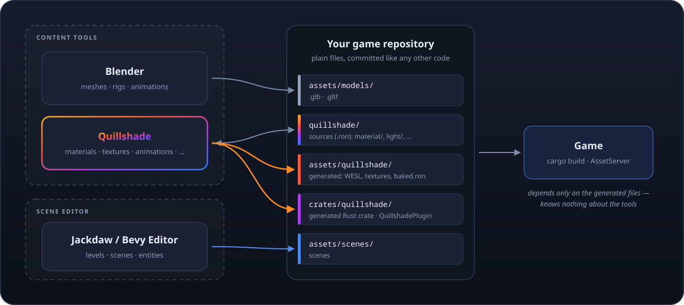
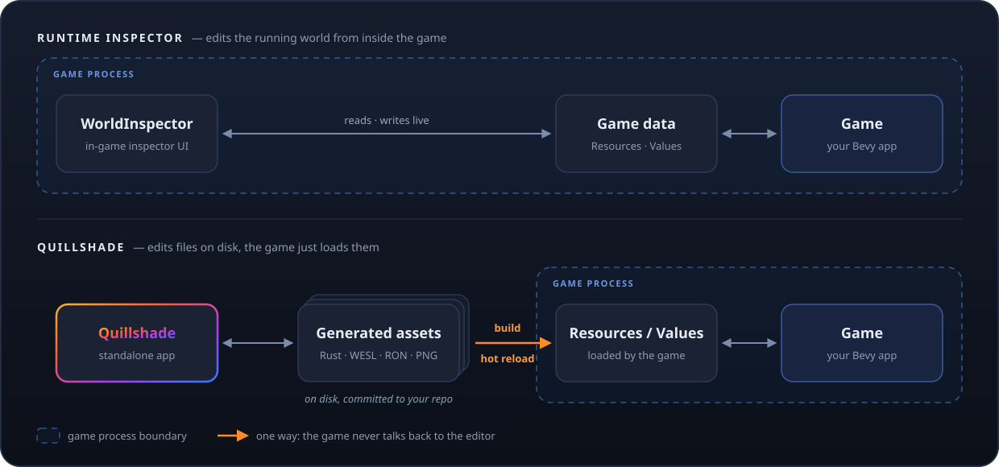
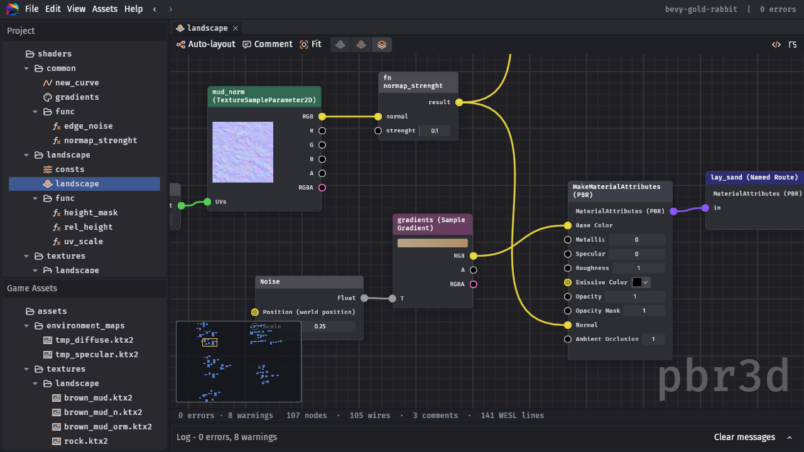
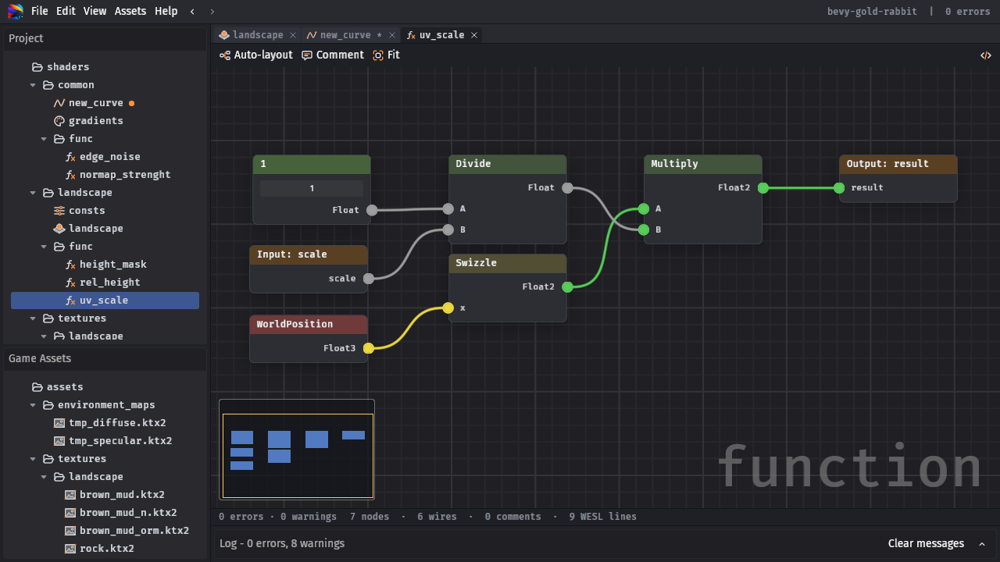
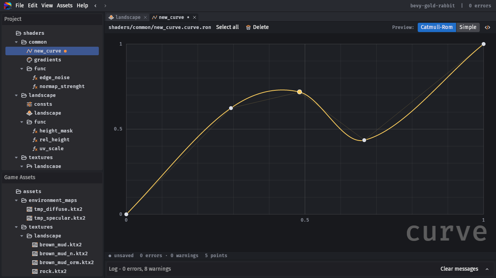
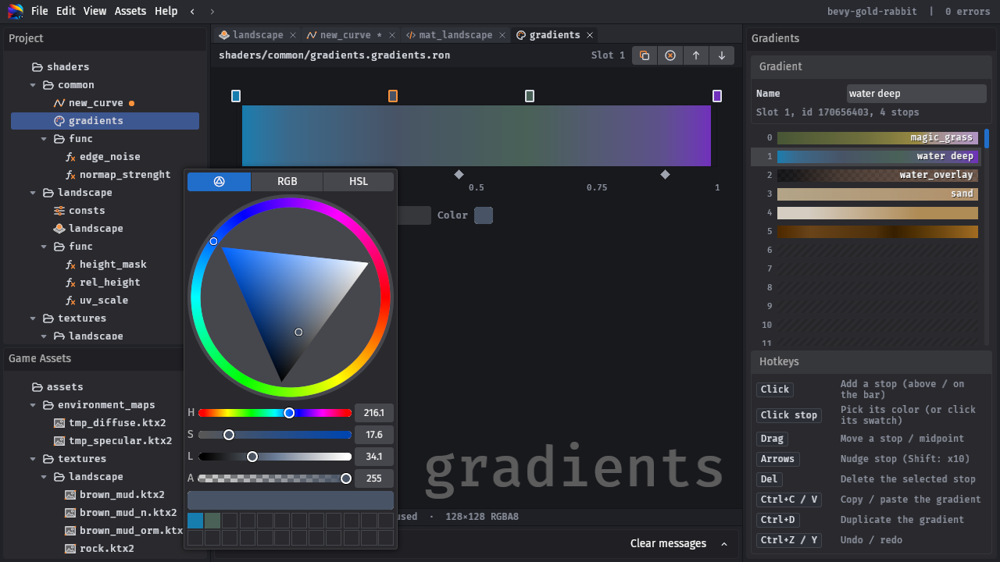
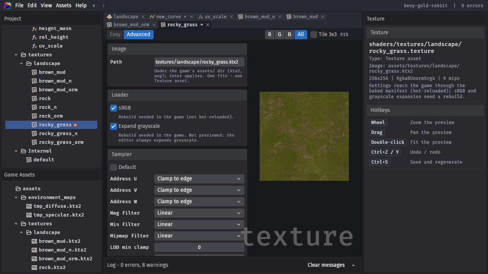
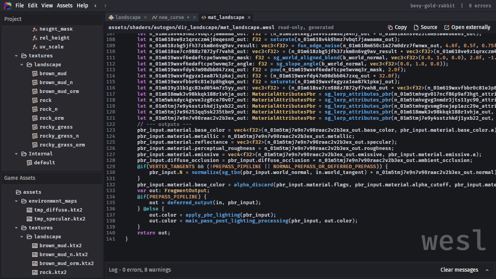
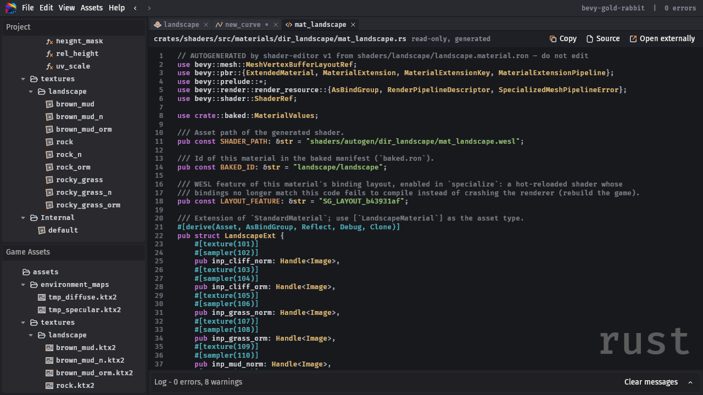

<p align="center">
  
</p>

<h1 align="center">Quillshade</h1>

<p align="center">
  <b>Standalone asset editor for <a href="https://bevy.org">Bevy</a>: author materials, textures, animations and other content.</b>
</p>

<p align="center">
  
  
  
  
</p>

> [!WARNING]
> **Alpha software — not stable, use at your own risk.** Quillshade is an unofficial, community-driven project and is
> not affiliated with or supported by the Bevy developers. File formats, generated code and the UI may change without
> notice between versions.
> Editor Code mostly written by LLMs

## What it is

Quillshade is an **external content tool** — closer to Blender than to the Unreal Editor. You run it next to your game,
it produces assets, and the game loads them like any other assets.

<p align="center">
  
</p>

- **Standalone.** A separate application that knows nothing about your game: not its components, systems, resources
  or scenes. It complements a scene editor such as [Jackdaw](https://github.com/jbuehler23/jackdaw) or the official
  Bevy editor instead of replacing it.
- **No levels, no scenes.** Placing entities and building levels is a scene editor's job; Quillshade does not do it
  and never will.
- **Not part of your build.** The game does not depend on Quillshade and does not know it exists. It depends only on
  the generated output — a plain Rust crate (Bevy, serde, ron), WESL shaders and data files — committed to your
  repository like hand-written code. Remove the editor and the game still builds.

In terms of data editing it is closer to a runtime inspector such as `WorldInspector`
([bevy-inspector-egui](https://github.com/jakobhellermann/bevy-inspector-egui)) — except it edits files on disk
instead of a running world:

<p align="center">
  
</p>


## Quick Start

### Download

Prebuilt binaries for Linux (x86_64), Windows (x86_64) and macOS (Apple Silicon, Intel) are attached to every
[release](https://github.com/fe3dback/bevy-quillshade/releases).

### Installation from source

Requires Rust ≥ 1.97.1 and the same system dependencies as Bevy itself (see
[Bevy setup](https://bevy.org/learn/quick-start/getting-started/setup/)).

```sh
git clone https://github.com/fe3dback/bevy-quillshade
cd bevy-quillshade
# Without the default `dynamic_linking` feature (fast builds while developing) the binary runs on its own.
cargo build --release --no-default-features
./target/release/shader-editor
```

### 1. Project

**File → New Project…** on your game crate (the directory with its `Cargo.toml`).

```text
my_game/
  Cargo.toml                 # yours: the editor never edits it
  quillshade/
    project.ron              # optional: which domains are enabled
    material/                # your graphs: *.material.ron, *.function.ron, *.texture.ron, ...
    light/                   # environments and cube maps: *.environment.ron, *.texture.ron
  assets/quillshade/material/autogen/    # generated WESL + baked.ron (do not edit)
  assets/quillshade/material/internal/   # built-in textures (generated)
  crates/quillshade/         # generated Rust crate, one module per domain (do not edit)
```

Sources live in `quillshade/<domain>/` (`material`, `light`); `quillshade/project.ron` can switch a domain off
(`domains: { "material": (enabled: false) }`, a missing entry means enabled). Without the file every default applies;
a `project.ron` that does not parse is an error — the CLI exits with code 2 and the editor refuses to open the project,
naming the file — rather than being replaced by defaults. The editor re-reads the file when it changes on disk.
In the editor, File → Project Settings... edits it: the
header date and each domain's "Used in game" (enabled by default). Saving writes the file and rewrites
`crates/quillshade/Cargo.toml` and `src/lib.rs` (unchecking a domain deletes its generated `crates/quillshade/src/<domain>/`
module, removes its plugin from `QuillshadePlugin`, and disables the domain in the editor while keeping its
`quillshade/<domain>/` source files); an outside edit reloads a clean Project Settings tab and asks Keep mine / Reload
for one with unsaved changes.

### 2. Cargo.toml

Add the generated crate to the game:

```toml
[workspace]
members = ["crates/quillshade"]

[dependencies]
bevy = { version = "0.20", features = ["file_watcher"] }   # file_watcher: hot reload
quillshade = { path = "crates/quillshade" }
```

### 3. Plugin

Add `QuillshadePlugin` after `DefaultPlugins`:

```rust
use bevy::prelude::*;

fn main() {
    App::new()
        .add_plugins((DefaultPlugins, quillshade::QuillshadePlugin))
        .add_systems(Startup, spawn)
        .run();
}
```

### 4. Spawn

Every material is a field of `BakedMaterials`, by its path under `quillshade/material/`:

```rust
use quillshade::material::BakedMaterials;

fn spawn(mut commands: Commands, mut meshes: ResMut<Assets<Mesh>>, baked: Res<BakedMaterials>) {
    // Pbr3d needs tangents for a Normal input.
    let sphere = Sphere::new(1.0).mesh().uv(48, 24).with_generated_tangents().unwrap();
    commands.spawn((Mesh3d(meshes.add(sphere)), MeshMaterial3d(baked.env.rock_wet.clone())));
    commands.spawn((Camera3d::default(), Transform::from_xyz(0.0, 1.0, 4.0)));
}

// Unlit3d: MeshMaterial3d(baked.fx.hologram.clone()) as well.
// Sprite2d: (Sprite::from_image(image), SpriteMaterial(baked.ui.dissolve.clone())).
// By id, e.g. from your own asset data (None for an unknown id or another type):
// baked.get::<RockWetMaterial>("env/rock_wet"), tex.get("textures/rock_albedo").
```

## Features

### Material Editor

Node-based material authoring in the spirit of the UE5 Material Editor. Graphs are saved as RON, and every save
regenerates WESL shaders and a typed Rust crate that the game hot-reloads.

<p align="center">
  
</p>

- **Three material kinds**: PBR 3D (an `ExtendedMaterial` over `StandardMaterial`, so shadows, prepass and deferred
  work out of the box), Unlit 3D and Sprite 2D. World Position Offset is supported too.
- **130+ built-in nodes**: math, vectors, colors, coordinates, textures, noise, masks and more. Implicit type
  conversions are applied on the wires.
- **Material Attributes**: make, break and blend whole PBR layers to build layered materials.
- **Functions**: reusable sub-graphs with their own inputs and outputs, shared across materials.
- **Custom code**: a Custom node with inline WESL, plus project-wide user nodes.
- **Curves**: a curve editor (Catmull-Rom or linear) whose curves are sampled from shaders.
- **Gradients**: collections of up to 128 gradients each (OKLab interpolation), baked into one texture per collection.
- **Textures**: Texture assets for the game's `.png` / `.ktx2` images, with loader and sampler settings and a preview.
- **Global constants**: named tables of values, inlined into every material that reads them.
- **Scene depth**: SceneDepth and DepthFade (soft particles, shorelines) read the camera's depth prepass in
  translucent 3D materials; add `DepthPrepass` to the camera.
- **Comfortable canvas**: comments, named routes, auto-layout, minimap, node preview, copy / paste,
  undo / redo, Back / Forward navigation.
- **Live validation**: errors and warnings are pinned to their node and pin, and an error blocks only its own asset.
- **Readable output**: view the generated WESL and Rust right in the editor. The game gets typed material structs and
  baked material and texture handles, and hot-reloads both the shaders and the baked values.
- **Headless CLI**: `regen`, `check` and `diff` for CI; `--domain <id>` (`material`, `light`; repeatable) limits a
  run to those domains (default: all), e.g. `shader-editor check my_game --domain light`.

<table>
  <tr>
    <td width="50%"><p align="center">Functions</p></td>
    <td width="50%"><p align="center">Curves</p></td>
  </tr>
  <tr>
    <td><p align="center">Gradients</p></td>
    <td><p align="center">Textures</p></td>
  </tr>
  <tr>
    <td><p align="center">Generated WESL</p></td>
    <td><p align="center">Generated Rust</p></td>
  </tr>
</table>

#### Planned

- **Instanced materials**: material instances that share draw calls (draw-call optimization).

### Light

> [!NOTE]
> **Planned for the next release.**

Set up the whole lighting environment from one editor: HDR environment map, skybox, lights, sun, fog and so on. All
the settings are stored as a single preset, and the game can switch between presets at runtime with a smooth
transition.

What is there already: `quillshade/light/` holds environments (`*.environment.ron`: a cube map, the skybox brightness
and the environment light intensity) and their cube maps as Texture assets (`*.texture.ron`, KTX2 cube maps only).
`regen` / `check` validate them with `L`-prefixed codes (`LE001` unknown cube map, `LW101` no cube map, `LE009`
unreadable file, and the Texture asset rules: `LE011` one image shared by several assets, `LE012` bad path, `LE013` bad
sampler, `LE014` not a cube map, `LW109` image missing) and generate `crates/quillshade/src/light/mod.rs`:
`QuillshadeLightInternalPlugin` (empty for now) and `ENVIRONMENTS`, the paths of the environments without errors
(`quillshade::light::ENVIRONMENTS`, e.g. `&["day"]`; `QuillshadePlugin` adds `light::QuillshadeLightInternalPlugin`
while Light is enabled). In the editor (the Light domain tab in the mainbar) the Assets menu has New Environment... and
New Texture...; an environment tab is a form (the cube map picked among the Light Texture assets, the two numbers, undo
/ redo, Ctrl+S saves and regenerates), a Light Texture tab is the texture editor without presets, previewing the cube
map's first face, and a `.ktx2` game file's menu has Create Texture Asset. Renaming a Light texture rewrites the
environments showing it; deleting it clears them (a warning).

### Animation Graph

> [!NOTE]
> **Planned for a future release.**

## Workspace crates

- `project_core` — domain-neutral backend: project layout, `project.ron`, atomic writer, regen driver, the umbrella
  `crates/quillshade`. `curve_kit` and `texture_kit` — models shared by domains (curves, texture assets), without
  Bevy; their `editor` feature (default on, off for generator backends) adds the curve editor every domain with
  curves registers (`CurveDomain`) and the Texture / game image tabs every domain with Texture assets registers
  (`TextureDomain`, its `TexturePolicy` decides the image formats, the built-in textures and the Easy presets).
- `shader_graph_core` → `shader_stdlib` → `shader_codegen_wesl` → `shader_codegen_rust` → `shader_project` — the
  Material domain's backend (model, node library, WESL and Rust codegen, regeneration), without Bevy.
- `editor_core` — the editor shell (Bevy UI + Feathers): window layout (the mainbar with the domain tabs, the
  secondbar with Back / Forward and the tabs), menus, trees, the console filtered by the active domain, dialogs, user
  config, undo history, property widgets, the generated-file viewer, tools (singleton tabs such as Project Settings,
  in the built-in Project domain) and the domain API (`EditorDomain`, `DomainRegistrar`, `DomainState`). It knows no
  domain.
- `node_graph_base` — the node graph UI every graph domain shares: the canvas over the `vendor/bevy_noodle` fork,
  its gestures, the palette, the minimap, in-node previews and the graph editor tools, behind `GraphDomain`.
- `light_domain` — the Light domain: environments and cube-map Texture assets (through `texture_kit`); its backend is
  Bevy-free, its `editor` feature (default on) adds `LightDomain`.
- `material_domain` — the Material domain of the editor: material and function graphs, curves and Texture assets
  (through the kits), constant tables, gradient collections and their editors. `src/main.rs` lists the domains (one
  line each) for the GUI and the CLI. See decision 0044 (`docs/decisions/`).
